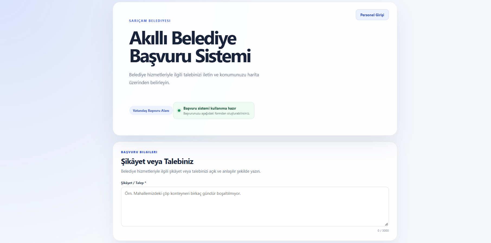

# Municipal AI Decision Support System

Full-stack **NLP decision-support platform** for Turkish municipal service requests.  
The system classifies incoming text with a **fine-tuned BERTurk model**, routes uncertain predictions to **human review**, and combines **FastAPI, React, PostgreSQL, and PostGIS** for end-to-end request processing and spatial analytics.


[**View the trained BERTurk model on Hugging Face →**](https://huggingface.co/deneme0001/berturk-municipal-complaint-classifier)


## Project Highlights

- **NLP Fine-tuning** — fine-tuned BERTurk for five Turkish municipal service-request categories.
- **Human-in-the-Loop AI** — uncertain or ambiguous predictions are routed to an operator instead of being automatically accepted.
- **Full-Stack Architecture** — React + TypeScript frontend, FastAPI REST API, PostgreSQL/PostGIS database, and ML inference in one workflow.
- **Traceable AI Decisions** — original model predictions and final human decisions are stored separately for later analysis.
- **Spatial Analytics** — radius and distance queries are executed directly with PostgreSQL/PostGIS.
- **Role-Based Access Control** — JWT authentication with separate operator and manager workflows.
- **Robustness Evaluation** — evaluation includes held-out testing, challenge cases, typo/noise examples, multi-issue requests, and out-of-distribution inputs.
- **Optional LLM Insights** — structured analytics can be summarized for managers without giving the external LLM direct database access.

## System Flow

```text
Citizen Request
      ↓
React + TypeScript
      ↓
FastAPI REST API
      ↓
Fine-tuned BERTurk
      ↓
Confidence / Margin Policy
   ↙                ↘
Auto Accept      Human Review
   ↘                ↙
PostgreSQL / PostGIS
      ↓
Analytics + GIS Dashboard
```

The fine-tuned BERTurk model is loaded once when the backend starts and reused for subsequent inference requests.

## Core Workflows

### Citizen Request Submission

Citizens can submit municipal service requests through a public-facing interface.

The request is validated by the backend, classified with the fine-tuned BERTurk model, and processed according to the confidence-based review policy.



### Human-in-the-Loop Review

Low-confidence or ambiguous predictions are escalated to an operator.

The review interface exposes the primary AI prediction, confidence score, secondary category, score margin, review reason, and final human decision.


The original AI prediction remains stored even if the operator selects a different final category, making AI-human disagreements measurable and traceable.

### Spatial Analytics with PostGIS

Managers can inspect request distribution geographically and perform radius-based nearby searches.


Spatial calculations are executed directly in PostgreSQL/PostGIS using functions such as `ST_DWithin` and `ST_Distance`.

### Optional LLM-Assisted Management Insights

The analytical backend calculates deterministic numerical and spatial results first.

An optional LLM layer can then convert those structured results into concise management summaries.


The LLM does **not** replace BERTurk classification, execute arbitrary SQL, or act as the primary analytics engine. Core application functionality remains available without the external LLM service.

## ML Evaluation

Final group-aware dataset split:

**1,167 train · 250 validation · 250 test**

| Evaluation | Accuracy | Macro-F1 |
|---|---:|---:|
| TF-IDF + Logistic Regression — held-out test | 1.000 | 1.000 |
| Frozen BERTurk + Linear Probe — held-out test | 0.904 | 0.904 |
| **Fine-tuned BERTurk — held-out test** | **0.992** | **0.992** |
| **Fine-tuned BERTurk — challenge set** | **0.940** | **0.941** |

Fine-tuning improved held-out accuracy by approximately **8.8 percentage points** compared with the frozen BERTurk linear-probe experiment.

The dataset is primarily synthetic. The perfect TF-IDF score suggests strong lexical separation in parts of the standard held-out split, so a separate challenge set was used to test more difficult examples including:

- cross-class distractors,
- indirect wording,
- multi-issue requests,
- lexical shortcuts,
- typo and noise cases.

For 50 out-of-distribution examples, **48/50 (96%)** were routed to human review by the confidence policy.

> The classifier is closed-set. Unsupported inputs still receive one of the five known labels, so the review mechanism acts as a safeguard rather than true open-set detection.

## Tech Stack

**Machine Learning / NLP:** Python, PyTorch, Hugging Face Transformers, BERTurk, scikit-learn  
**Backend:** FastAPI, Pydantic, SQLAlchemy, Alembic, REST API  
**Database / GIS:** PostgreSQL, PostGIS, GeoAlchemy2  
**Frontend:** React, TypeScript, Vite, Leaflet, Turf.js  
**Security:** JWT Authentication, Role-Based Access Control  
**Optional AI Insights:** External LLM API for management summaries

## Quick Start

### 1. Clone the repository

```bash
git clone https://github.com/OzanDural/municipal-ai-decision-support.git
cd municipal-ai-decision-support
```

Create a Python virtual environment:

```bash
python -m venv .venv
```

Windows PowerShell:

```powershell
.\.venv\Scripts\Activate.ps1
```

Install dependencies:

```bash
pip install -r requirements.txt
```

### 2. Download the trained model

The fine-tuned model weights are hosted separately on Hugging Face.

```bash
pip install -U huggingface_hub
hf download deneme0001/berturk-municipal-complaint-classifier --local-dir ml/models/berturk/final_model
```

### 3. Configure the backend

Copy:

```text
backend/.env.example
```

to:

```text
backend/.env
```

Configure your PostgreSQL credentials and JWT secret.

The LLM API key is optional and is only required for the manager-assistant feature.

Enable PostGIS:

```sql
CREATE EXTENSION IF NOT EXISTS postgis;
```

Apply database migrations:

```bash
cd backend
python -m alembic upgrade head
cd ..
```

Create application users:

```bash
python -m backend.scripts.create_user operator OPERATOR
python -m backend.scripts.create_user manager MANAGER
```

The repository also includes scripts for importing the bundled service-area data and creating optional demo complaints.

Start the backend:

```bash
python -m uvicorn backend.app.main:app --host 127.0.0.1 --port 8000
```

Swagger UI:

```text
http://127.0.0.1:8000/docs
```

### 4. Start the frontend

Copy:

```text
frontend/.env.example
```

to:

```text
frontend/.env
```

Then run:

```bash
cd frontend
npm install
npm run dev
```

Frontend:

```text
http://localhost:5173
```

## Verification

Backend test suite:

```bash
python -m pytest backend/tests -q
```

Latest verified local result:

```text
45 passed
```

Frontend checks:

```bash
cd frontend
npm run lint
npm run build
```

The automated test suite covers authentication and RBAC, complaint processing, human review, real BERTurk inference, manager analytics, address validation, service-area functionality, and PostGIS queries.

## Limitations

This project is a **technical decision-support prototype**, not a production municipal system.

The current ML dataset is primarily synthetic, the classifier is limited to five closed-set categories, and softmax scores should not be interpreted as perfectly calibrated real-world probabilities.

Production deployment would require representative real-world data, additional model monitoring and calibration, security hardening, audit logging, operational integration, and production infrastructure.

The system is designed to **support human decisions rather than replace them**.