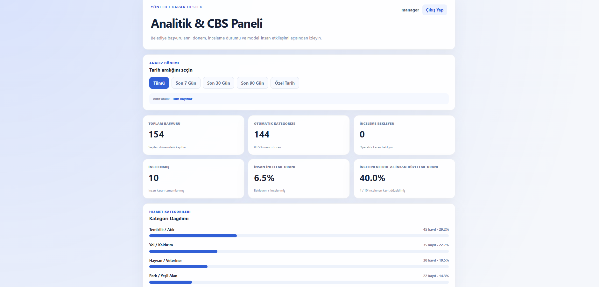
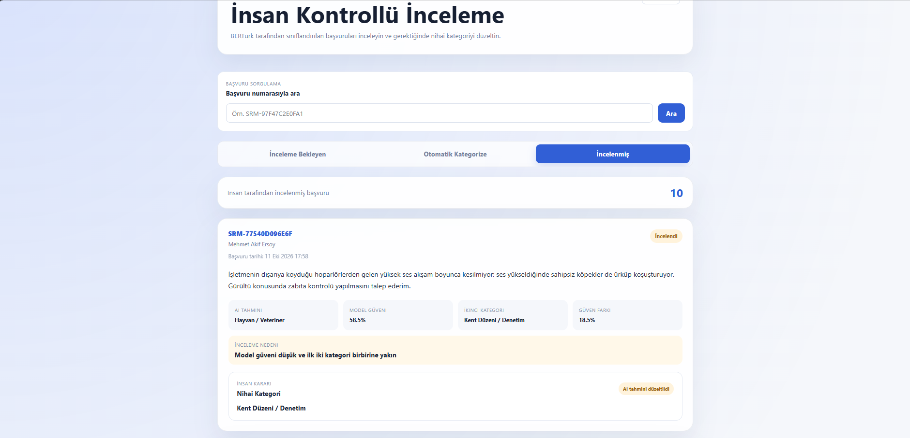
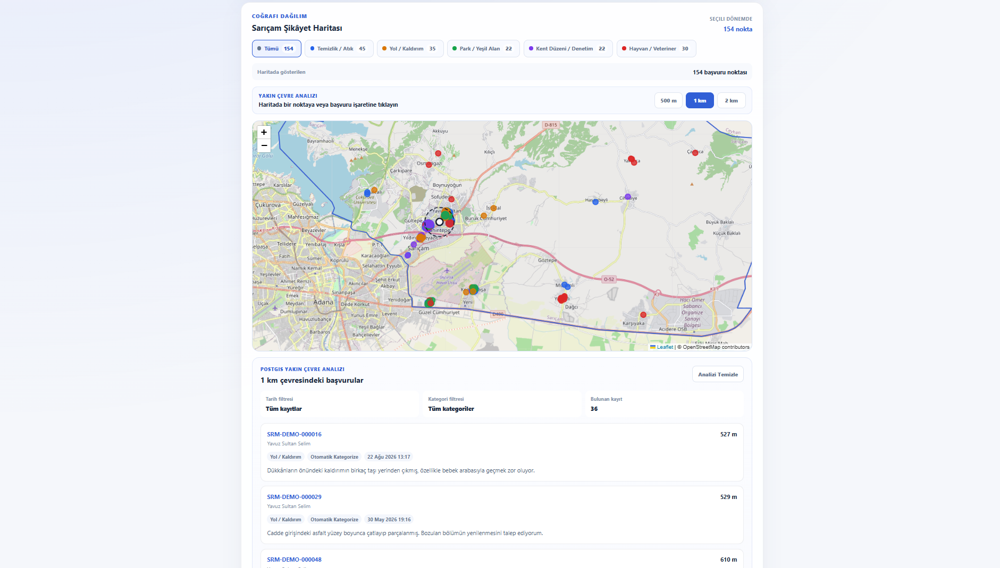
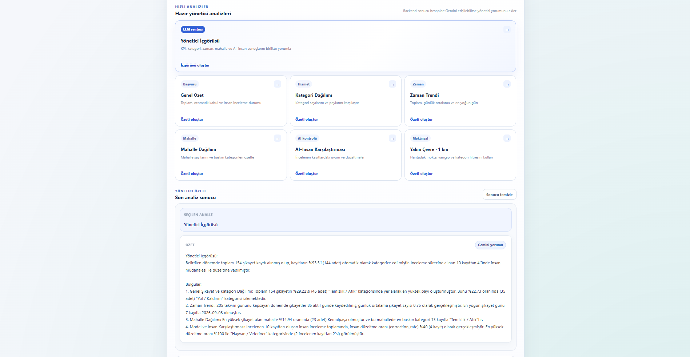

# Municipal AI Decision Support System

AI-assisted municipal request processing with **fine-tuned BERTurk**, **human-in-the-loop review**, and **PostGIS spatial analytics**.


[**View the trained model on Hugging Face →**](https://huggingface.co/deneme0001/berturk-municipal-complaint-classifier)



## Why it stands out

- **NLP Fine-tuning** — BERTurk fine-tuned for five Turkish municipal service-request categories.
- **Human-in-the-Loop** — uncertain predictions are routed to an operator instead of being blindly accepted.
- **Traceable AI Decisions** — the original model prediction and final human decision are stored separately.
- **Spatial Analytics** — real radius and distance queries with PostgreSQL/PostGIS.
- **Full-Stack Workflow** — React + TypeScript frontend, FastAPI REST API, JWT authentication, and RBAC.
- **Robustness Evaluation** — testing goes beyond the standard held-out set with challenge and out-of-distribution cases.
- **Optional LLM Insights** — structured backend analytics can be summarized for managers without giving the LLM direct database access.

## Architecture

```text
React + TypeScript
        |
        v
     FastAPI
        |
        v
 BERTurk Inference
        |
        v
Confidence / Margin Policy
     /            \
    v              v
Auto Accept    Human Review
     \            /
      v          v
   PostgreSQL / PostGIS
          |
          v
   Analytics + GIS
```

The **fine-tuned BERTurk model** is loaded once when the backend starts and reused for subsequent inference requests.

## Core Workflow

### Human-in-the-Loop Review

Low-confidence or ambiguous predictions are escalated to a human reviewer.

The interface exposes the primary AI prediction, confidence score, secondary category, score margin, review reason, and final human decision.



The original AI prediction remains available even if the operator selects a different final category, allowing AI-human disagreements to be analyzed later.

### Spatial Analytics with PostGIS

Managers can inspect request distribution on a map and run radius-based nearby searches.



Distance calculations are performed directly in PostgreSQL/PostGIS using spatial functionality such as `ST_DWithin` and `ST_Distance`.

### Optional LLM-Assisted Insights

The analytical backend calculates numerical and spatial results first. An optional **LLM** layer can then transform those structured results into a concise management summary.



The LLM does **not** replace BERTurk classification, execute arbitrary SQL, or act as the primary analytics engine. The core application continues to work without the external LLM service.

## ML Evaluation

Final dataset split:

**1,167 train · 250 validation · 250 test**

| Evaluation | Accuracy | Macro-F1 |
|---|---:|---:|
| TF-IDF + Logistic Regression — held-out test | 1.000 | 1.000 |
| Frozen BERTurk + Linear Probe — held-out test | 0.904 | 0.904 |
| **Fine-tuned BERTurk — held-out test** | **0.992** | **0.992** |
| **Fine-tuned BERTurk — challenge set** | **0.940** | **0.941** |

Fine-tuning improved held-out accuracy by approximately **8.8 percentage points** compared with the frozen BERTurk linear-probe experiment.

The dataset is primarily synthetic, and the perfect TF-IDF score indicates strong lexical separation in parts of the held-out set. For that reason, a separate challenge set was used to evaluate harder cases including distractors, indirect wording, multi-issue requests, and typo/noise examples.

For 50 out-of-distribution examples, **48/50 (96%)** were routed to human review by the confidence policy.

> The classifier is closed-set. Unsupported inputs still receive one of the five known labels, so the review mechanism acts as a safeguard rather than true open-set detection.

## Tech Stack

**ML / NLP:** PyTorch, Transformers, BERTurk, scikit-learn
**Backend:** FastAPI, Pydantic, SQLAlchemy, Alembic
**Database / GIS:** PostgreSQL, PostGIS, GeoAlchemy2
**Frontend:** React, TypeScript, Vite, Leaflet, Turf.js
**Security:** JWT, Role-Based Access Control

## Quick Start

### 1. Clone and create the Python environment

```bash
git clone https://github.com/OzanDural/municipal-ai-decision-support.git
cd municipal-ai-decision-support

python -m venv .venv
```

Windows PowerShell:

```powershell
.\.venv\Scripts\Activate.ps1
```

Install dependencies:

```bash
pip install -r requirements.txt
```

### 2. Download the trained model

The model weights are hosted separately on Hugging Face.

```bash
pip install -U huggingface_hub

hf download deneme0001/berturk-municipal-complaint-classifier --local-dir ml/models/berturk/final_model
```

### 3. Configure the backend

Copy:

```text
backend/.env.example
```

to:

```text
backend/.env
```

Then configure your PostgreSQL credentials and JWT secret.

The LLM API key is optional and is only required for the manager-assistant feature.

Enable PostGIS in the application database:

```sql
CREATE EXTENSION IF NOT EXISTS postgis;
```

Apply database migrations:

```bash
cd backend
python -m alembic upgrade head
cd ..
```

Create application users:

```bash
python -m backend.scripts.create_user operator OPERATOR
python -m backend.scripts.create_user manager MANAGER
```

Start the backend:

```bash
python -m uvicorn backend.app.main:app --host 127.0.0.1 --port 8000
```

Swagger UI:

```text
http://127.0.0.1:8000/docs
```

### 4. Start the frontend

Copy:

```text
frontend/.env.example
```

to:

```text
frontend/.env
```

Then run:

```bash
cd frontend
npm install
npm run dev
```

Frontend:

```text
http://localhost:5173
```

## Verification

Backend test suite:

```bash
python -m pytest backend/tests -q
```

Latest local result:

```text
45 passed
```

Frontend checks:

```bash
cd frontend
npm run lint
npm run build
```

The automated tests include authentication, complaint processing, human review, real BERTurk inference, manager analytics, and PostGIS functionality.

## Limitations

This project is a **technical decision-support prototype**, not a production municipal system.

The current ML dataset is primarily synthetic, the classifier is limited to five closed-set categories, and softmax scores should not be interpreted as perfectly calibrated real-world probabilities.

Production deployment would require representative real-world data, additional monitoring and calibration, security hardening, auditing, and integration with operational systems.

The system is designed to **support human decisions rather than replace them**.